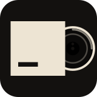

<h1 align="center">Albumscape Lock</h1>

<b>Your music, full screen on your Mac's lock screen.</b> 
Whatever you're playing fills your lock screen: the album's animated cover, the music video, lyrics, the time.

  <a href="https://github.com/aosmannn/albumscape-lock/releases/latest/download/AlbumscapeLock-mac.dmg"><b>⬇ &nbsp;Download for Mac</b></a>
  &nbsp;·&nbsp;
  <a href="https://github.com/aosmannn/albumscape">Albumscape for Windows</a>

Free · macOS 14 or newer · no account · works with Spotify and Apple Music

---

## Get started in 3 steps

**1. Download it.** Click **[Download for Mac](https://github.com/aosmannn/albumscape-lock/releases/latest/download/AlbumscapeLock-mac.dmg)** and open the file. Drag **AlbumscapeLock** onto the **Applications** folder in the window that appears.

**2. Open it from Applications.** The first time, your Mac says it can't check the app (it's new and not registered with Apple yet). That's expected: open **System Settings → Privacy & Security**, scroll down, and click **Open Anyway**. You only do this once.

**3. Allow Spotify or Music.** A small icon appears in your menu bar. Click **Allow** when your Mac asks to let it see what's playing.

That's it. **Play a song** and lock your Mac.

---

## What it does

- **Animated album art.** Albums with moving covers on Apple Music play them full screen.
- **Music videos.** The song's music video plays in step with the song, with the animated cover or the cover underneath until it's ready. Turn videos off in the menu bar to see only animated covers.
- **Lyrics** that fill in word by word, and a progress bar in the album's own colour.
- **A Liquid Glass player.** Click the picture to shrink it to a small player: play, next, back, a heart for your liked songs (with Spotify connected), and a sound-output picker.
- **Nothing playing?** Your lock screen and desktop shuffle through the animated covers of albums you've played. Click to skip one.
- **Optional extras:** the animated cover behind your desktop icons.

## Controls

- **Click** the picture to shrink or enlarge it.
- **Click the L** in the top-left corner for lyrics. When nothing is playing, **click** to skip to another animated cover.
- **Settings:** open the app (or the menu bar icon › Settings) to choose music videos, the shuffle, lyrics, the desktop wallpaper, Spotify and the 24-hour clock.

## Good to know

- It draws over the lock screen with private macOS calls and reads Apple Music's public pages for the animations, so a Mac update can break it. It isn't on the App Store.
- The heart needs a free Spotify app of your own. Setup is in [the advanced page](docs/ADVANCED.md).
- Build it yourself: install Xcode, then `./build-app.sh`.

## Credits

Made by [@aosmannn](https://github.com/aosmannn). Lyrics from [LRCLIB](https://lrclib.net). Covers and animations come from Apple Music's public pages. MIT license.
